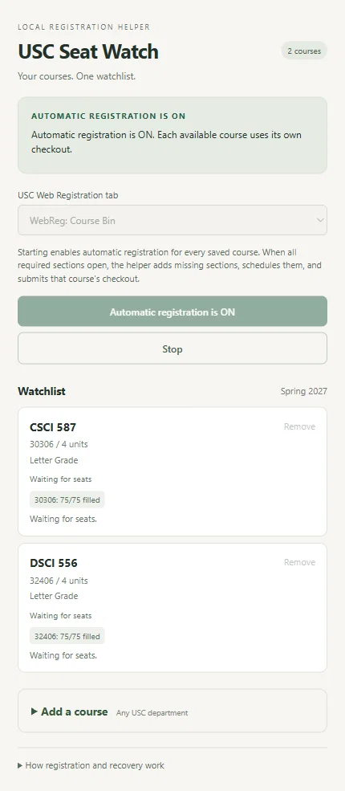
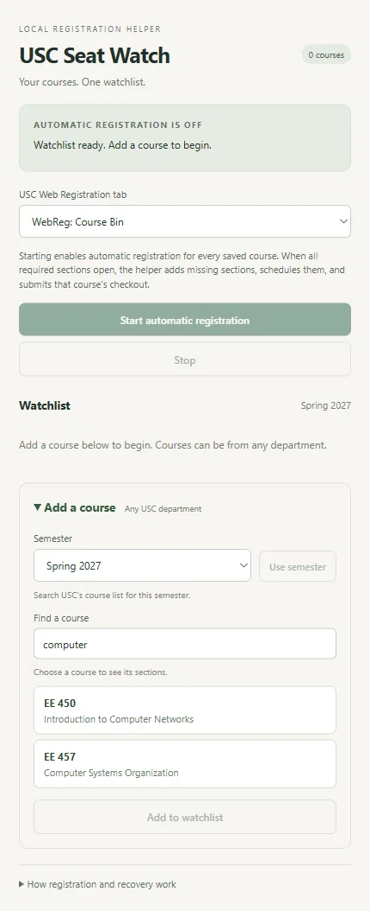

# USC Seat Watch

A local Chrome extension that watches USC course sections and submits one available course group per checkout. Search by course code or title, choose the lecture and required labs or discussions, and add them to your watchlist.

USC checkout includes all pending changes. Seat Watch temporarily unschedules other unregistered selections, checks out the available course, then restores those selections. It keeps a recovery journal and pauses when USC's response leaves a change or submission uncertain.

## Screenshots

| Monitor your watchlist | Search courses by code or title |
| --- | --- |
| <a href="docs/screenshots/watchlist.webp"></a> | <a href="docs/screenshots/course-search.webp"></a> |

Screenshots show the real popup with fabricated sample data. Course sections,
seat counts, and instructors are illustrative. Click an image to enlarge it;
see [section selection and recovery](docs/screenshots/README.md) for more views.

## Install

Requires Chrome 120 or later. No Node.js or build step is needed to use the extension.

1. Download `usc-seat-watch-v2.1.1.zip` from [Releases](https://github.com/5ham5h33r/usc-seat-watch/releases/latest) and extract it to a permanent folder.
2. Open `chrome://extensions`, enable **Developer mode**, and click **Load unpacked**.
3. Select the extracted `usc-seat-watch` folder containing `manifest.json`.
4. Sign in to USC Web Registration, choose your semester, and reload that tab.
5. Open USC Seat Watch, expand **Add a course**, choose your semester, search for a course, and select all required sections. Click **Add to watchlist** and repeat for other courses.
6. Select your USC tab and click **Start automatic registration**.

Fresh installations start with an empty watchlist. Review units and grade choices in WebReg before starting. Separate watchlist entries represent enrollments you want, rather than alternative sections or course swaps.

For an update, click **Stop** and finish any recovery first. Extract the new ZIP over the existing extension folder, click **Reload** on the extension card, then reload the USC tab. Keeping the same folder preserves the installation's identity and saved watchlist. Source users can clone this repository and load its `extension` folder instead.

## Monitoring and sign-in

| Activity | Timing |
| --- | --- |
| Public seat checks | About every 30 seconds while enabled |
| USC session health check | Every 5 minutes and during registration |
| Failed lookup | Increasing backoff; honors USC's retry instructions |

Closing the popup leaves an enabled watch running. **Stop** silences notifications and stops new submissions while the helper restores known selection changes. Chrome startup and extension updates require you to click Start again. Keep Chrome open, the laptop powered, and the lid open.

The helper can reuse an existing SSO session. Complete password, Windows Hello passkey, Duo, or other prompts yourself when they appear. Monitoring can continue while sign-in waits; checkout requires a valid session.

**An opening or a Submit click does not guarantee enrollment.** Verify the result in USC. Holds, restrictions, deadlines, seat contention, sleep, or USC layout changes can prevent registration. The production multi-course transaction has not yet been verified against a live opening; automated tests use simulated USC responses.

## Documentation

- [Course setup, isolated checkout, and recovery](docs/usage.md)
- [Privacy, stored data, and permissions](docs/privacy.md)
- [Login recovery findings](docs/login-recovery.md)
- [Changes in this release](CHANGELOG.md)
- [Contributing and release process](CONTRIBUTING.md)
- [Security reporting](SECURITY.md)

## Development

Use Node.js 22 or later and Git:

```sh
npm ci
npm run check
npm run package
```

Checks cover manifest resources and permissions, syntax, catalog search, popup behavior, isolated checkout, recovery, cancellation, notification gating, and rate limits. Packaging requires a clean Git checkout and writes a ZIP and SHA-256 checksum to `dist/`. The archive contains the committed extension and license; development dependencies stay out of the release.

This project independently implements local monitoring and guarded checkout. The original Schedule Helper's public source is [USC-Class-Notifier-API](https://github.com/jonluca/USC-Class-Notifier-API). USC Seat Watch is an independent project with no affiliation with the University of Southern California.

[MIT license](LICENSE).
