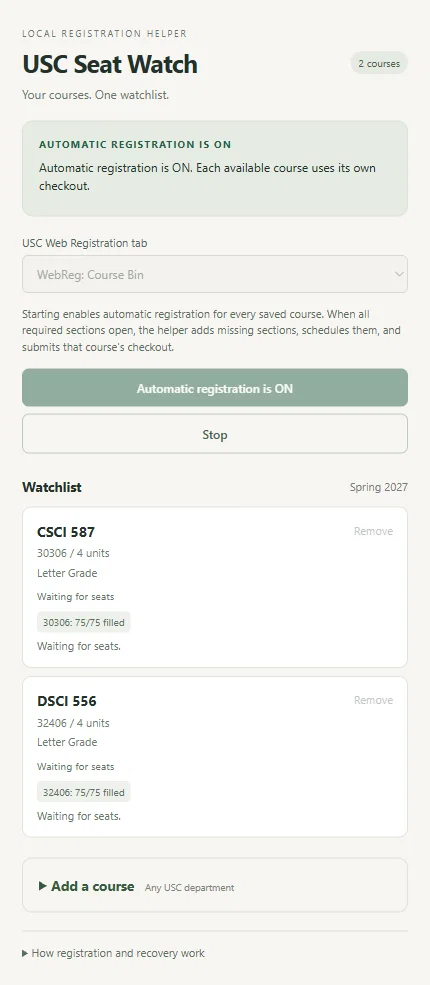
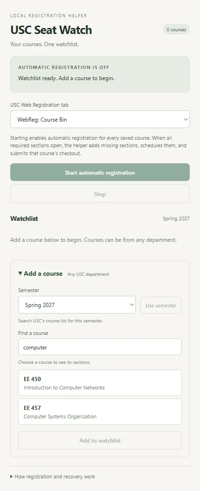
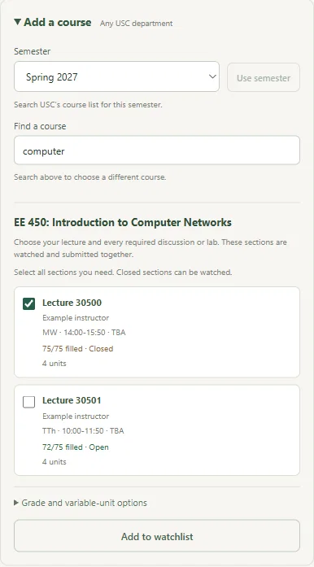
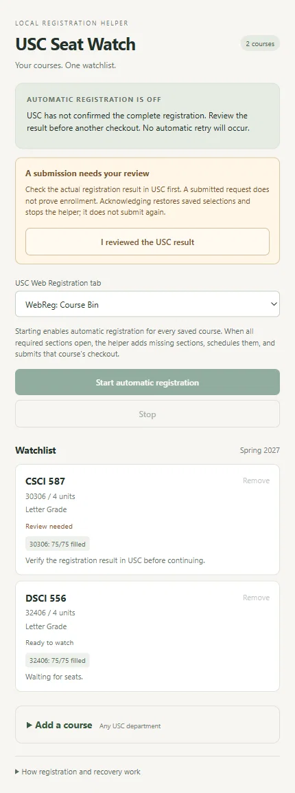

# Interface screenshots

These screenshots use the actual `extension/popup.html`, CSS, and popup code
from version 2.1.1, rendered in Chromium. The preview supplies fabricated data
in place of Chrome extension APIs. It loads no service worker, contacts no USC
endpoint, and cannot submit registration or change an account.

Course sections, seat counts, instructors, and meeting details are illustrative.
No account information or live registration result appears in the images.

## Watchlist

An enabled watch shows per-course status and section seat counts. Stop remains
available while course editing stays locked.



## Course search

Choose the semester and search by code, department, or course title.



## Section selection

Select the lecture and all required components. A full section can be watched.
USC supplies fixed unit values; variable units require a choice.



## Submission review

An uncertain checkout result pauses the watch and keeps Start disabled until
you review the result and complete recovery.



## Reproduce

From the repository root, run:

```sh
node scripts/preview.mjs
```

Open `http://127.0.0.1:4317/?view=watchlist` in a local browser. Other views are
`search`, `sections`, and `recovery`. Use a 430-pixel-wide viewport and device
scale factor 1. The preview loads the original popup assets without changing
their appearance.

For search, enter `computer`. For section selection, choose **EE 450**, select
the first lecture, and capture the **Add a course** panel. Other views use
full-page captures. Export WebP at quality 85 and review the result before
replacing an image. Stop the preview server with Ctrl+C when finished.
